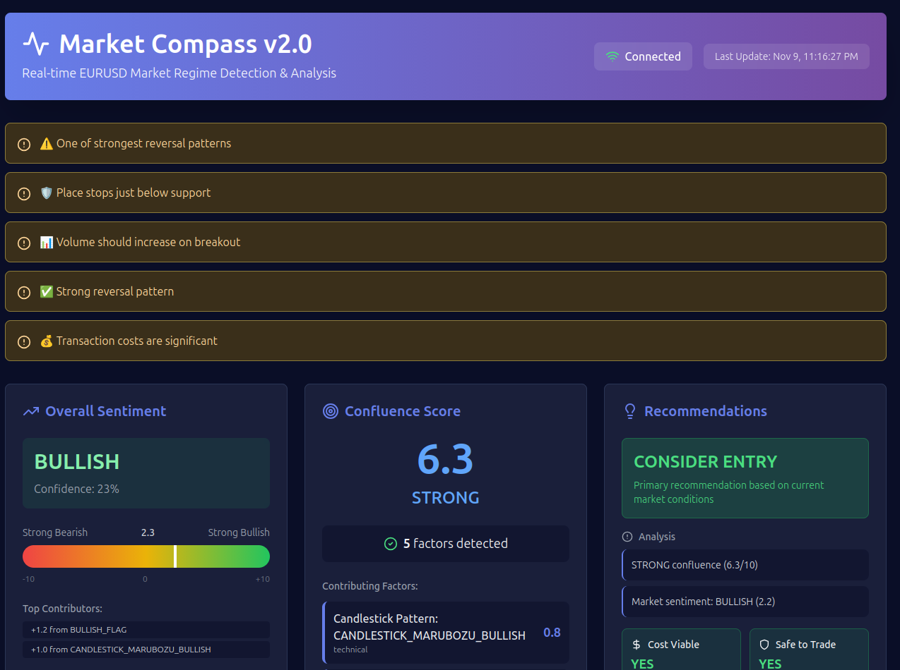
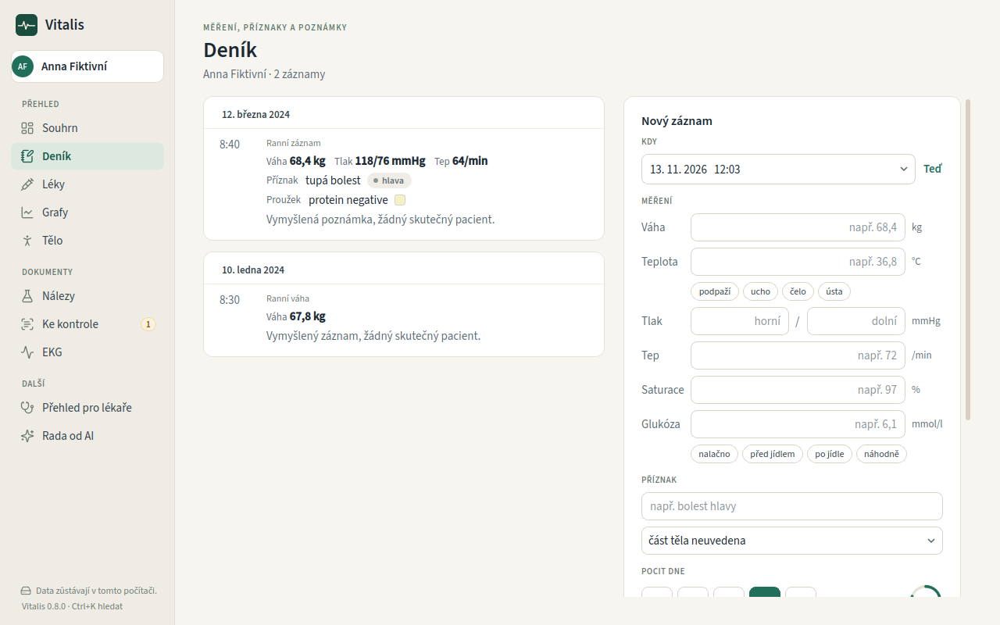
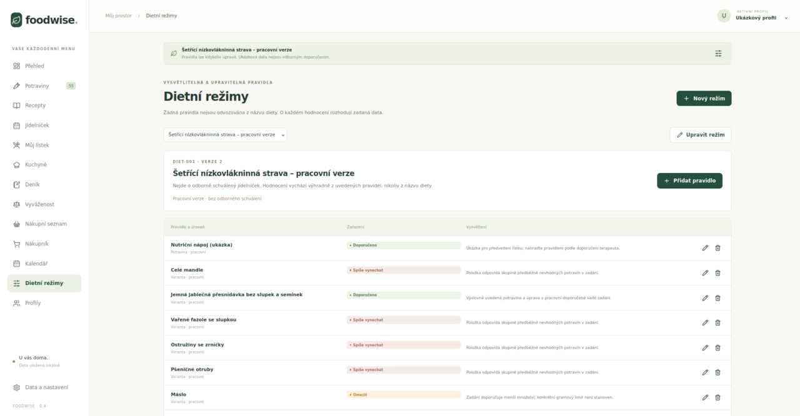
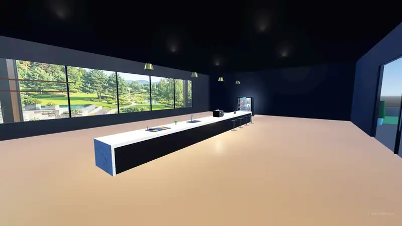
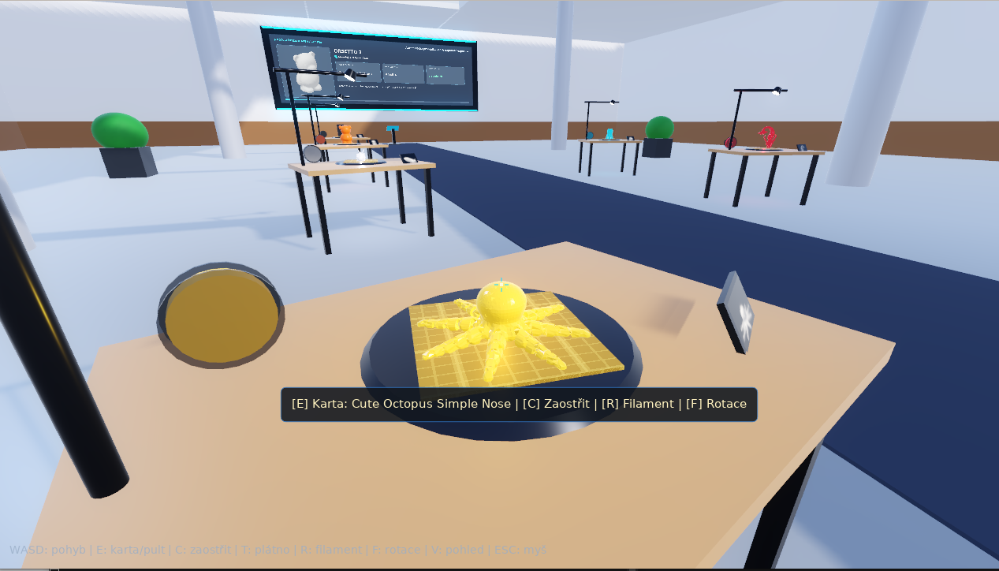

# Vítězslav

Pro zábavu píšu software v Pythonu: lokální desktopové a webové aplikace, zpracování
dat v reálném čase a 3D vizualizace v Godotu. Obvykle stavím jedno dobře otestované jádro, nad ním tenká
rozhraní, a data nechávám u uživatele.

Zdrojový kód zatím není veřejný.

| Projekt | Co to je | Technologie |
|---|---|---|
| [Market Compass](#market-compass) | Rozpoznávání stavu trhu EUR/USD v reálném čase | FastAPI, WebSockets, React, TimescaleDB |
| [Vitalis](#vitalis) | Lokální deník zdraví pro rodinu s OCR laboratorních výsledků | Python, PyQt6, SQLite |
| [FoodWise](#foodwise) | Plánování jídel s vysvětlitelnými dietními pravidly | FastAPI, React, SQLite |
| [Virtuální dům](#virtuální-dům) ▶ | 3D svět s režisérem kamery, který si sám natočí video | Godot 3.6, GDScript, Python |
| [3D galerie](#3d-galerie) | Virtuální výstava modelů pro 3D tisk | Godot 3.6, Python |

---

### Market Compass

**Rozpoznávání stavu trhu EUR/USD v reálném čase**

Sleduje živé ceny EUR/USD a popisuje aktuální stav trhu: trendy, pásma, cenové a svíčkové
formace, úrovně supportu a rezistence a vliv obchodních seancí. Jednotlivé detektory se
skládají do jednoho skóre souběhu (confluence), které počítá i s transakčními náklady.

- **Datový tok:** data z MetaTraderu 5 → analytické jádro v Pythonu (pandas, TA-Lib) →
  FastAPI se streamováním přes WebSocket → dashboard v Reactu a TypeScriptu.
- **Úložiště a nasazení:** cache v Redisu, časové řady v TimescaleDB, Docker Compose.
- **Výzkum:** příprava příznaků (feature engineering), modely ve scikit-learn
  a walk-forward backtesting.

`Python 3.11` · `FastAPI` · `WebSockets` · `pandas` · `TA-Lib` · `scikit-learn` · `Redis` · `TimescaleDB` · `React` · `Docker` 
*Analytický nástroj, ne investiční doporučení. Netvrdí nic o ziskovosti.*

### Vitalis

**Lokální deník zdraví pro celou rodinu**

Měření, příznaky, laboratorní výsledky a naskenované lékařské zprávy zůstávají na vlastním
počítači. Aplikace zaznamenává a kreslí grafy, nediagnostikuje.

- **Architektura:** jedno jádro nad SQLite a nad ním tenká rozhraní: příkazová řádka
  (jediné rozhraní i pro AI agenty), desktopová aplikace v PyQt6 a volitelné místní JSON API
  pro ukázku v Godotu 3.6.
- **Dokumenty:** importuje fotky a PDF laboratorních výsledků a čte je lokálním OCR
  (Tesseract). U podporovaného typu výpisu navrhne hodnoty. Každou musí potvrdit člověk,
  teprve pak se započítá do grafů a trendů.
- **Soukromí:** ve výchozím stavu nic neopouští počítač. Volitelné vysvětlení od AI jde přes
  místní AI CLI, a to až poté, co uživatel uvidí a schválí přesný text. Každý dotaz se
  zapíše do místního logu.
- **Kvalita:** typy kontroluje mypy `--strict`, styl Ruff, testy běží v pytestu
  a pytest-qt. CI pro Linux a Windows.

`Python 3.11` · `PyQt6` · `SQLite` · `Pydantic` · `Tesseract OCR` · `Godot 3.6` 
Verze 0.8.0. *Na screenshotu jsou vymyšlená data.*

### FoodWise

**Plánování jídel s vysvětlitelnými dietními pravidly**

Plánuje jídla pro domácnost, ve které má každý jinou dietu. Dieta je sada upravitelných
pravidel a u každého hodnocení je vidět, které pravidlo o něm rozhodlo. Nic se neodvozuje
z názvu diety.

- **Pravidla:** pět úrovní hodnocení. Alergeny a osobní vyloučení mají přednost. Neznámé
  nebo rozporné pravidlo vede na „nutno ověřit“, ne na odhad. Každá změna má verzi a jde
  vrátit.
- **Plánování:** deterministický plánovač na 1–7 dní se zamčenými jídly a limitem
  opakování, recepty přepočítané podle porce a společný nákupní seznam. Každý strávník
  si vybírá ze sdíleného lístku v telefonu a kuchyně podle toho plánuje vaření a nákup.
- **Data:** nutriční hodnoty pocházejí z tabulky složení potravin Ciqual 2025 a u každé
  je evidovaný zdroj a kvalita. Chybějící hodnota zůstane prázdná, nikdy nula.
- **Kvalita:** testy v pytestu pro pravidla, alergeny, porce, plány, import a oddělení
  profilů, k tomu testy frontendu. Běží úplně offline: bez účtu, bez cloudu, bez AI modelu.

`Python 3.12` · `FastAPI` · `Pydantic 2` · `SQLAlchemy 2` · `Alembic` · `SQLite` · `React 19` · `TypeScript` 
Verze 0.4.0. *Ukázková data. Dietní pravidla jsou ukázka, ne lékařské doporučení.*

### Virtuální dům

**3D svět v Godotu s režisérem kamery, který si sám natočí video**

Svět v Godotu, kterým se dá procházet: vzorový dům s kuchyní, terasou a bazénem
a obchodní velín, na jehož obrazovkách běží vizualizace tickových dat z TickForge,
mé datové vrstvy pro ticková data napsané v Zigu.

- **Studio2, režisér kamery:** video není záznam obrazovky. Vyrenderoval ho režisér
  kamery, kterého jsem napsal v GDScriptu, podle scénáře v JSONu: body trasy, plynulé
  pohyby kamery po křivkách, zorné pole a časované interakce. Umí také nahrát mou vlastní
  procházku, vyhladit ji a převést na scénář.
- **Nástroje v příkazové řádce:** prohledají scénu, najdou interaktivní předměty a navrhnou
  záběry, zkontrolují scénář před renderem a spojí klipy přes ffmpeg.
- **Svět:** pohyb z první i třetí osoby, interaktivní předměty jako lednice, dveře nebo
  knihy a obrazovky, které se po přiblížení přepnou do čitelného 2D detailu.

`Godot 3.6` · `GDScript` · `Python` · `ffmpeg` 
*Ukázka z 56sekundové prohlídky, kterou celou vyrenderovalo Studio2.* [Stáhnout celé video (MP4, 9 MB)](https://github.com/vskupina/vskupina/releases/download/video-prohlidka/virtualni-dum-prohlidka.mp4)

### 3D galerie

**Procházka sbírkou modelů pro 3D tisk**

Ze složek se staženými STL soubory udělá virtuální výstavu. Modely stojí na skleněných
podstavcích, takže je jde obejít a podívat se na ně i zespodu, kde je u tištěných dílů
často to nejdůležitější. Sbírku jde procházet i ve 2D katalogu s vyhledáváním, nebo
v první osobě po výstavní hale.

- **Godot 3.6 (GDScript):** načítání STL, 3D vitrína a 2D katalog, rozložení do mřížky
  8 × 8 a procházka v první osobě.
- **Nástroje v Pythonu:** projdou složky, odstraní duplicity, zmenší velké modely vlastní
  decimací shlukováním vrcholů, označí vady jako otevřené hrany, vyrenderují náhledy
  a udržují přírůstkový katalog.
- **Testovatelnost:** režim bez okna, který podle zadaných parametrů kamery uloží snímek
  pro vizuální kontrolu.

`Godot 3.6` · `GDScript` · `Python` 
*Kamera a rozvržení vycházejí z dema Material Testers pro Godot. Modely na screenshotu
patří jejich autorům.*
